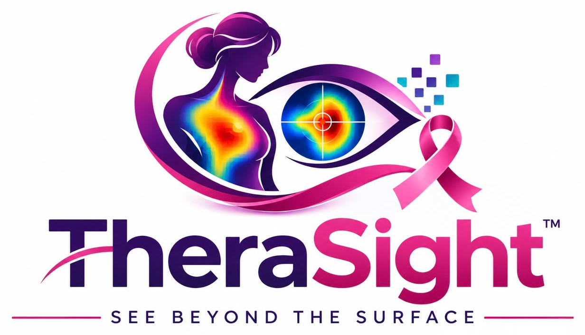
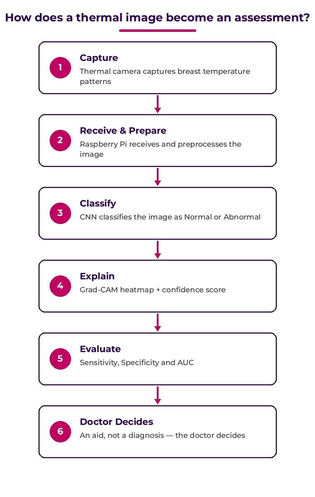

  

  <b>SEE BEYOND THE SURFACE</b>

  
  
  

---

## About

For women who notice changes in their breasts, timely assessment matters. However, travel, waiting times, and concerns surrounding conventional examinations can make seeking medical attention more difficult.

**TheraSight** is a non-contact breast thermal imaging system designed to support breast health assessment using infrared thermography and artificial intelligence. An infrared thermal camera will capture temperature patterns across the breast, which will be processed and analyzed using a Convolutional Neural Network (CNN) to classify images into **Normal** and **Abnormal** categories, based on the publicly available DMR-IR breast thermography dataset.

To make the model's predictions more interpretable, TheraSight will incorporate **Grad-CAM** to generate visual heatmaps highlighting the image regions that influence each prediction. These visual explanations will allow doctors and researchers to inspect whether the model is focusing on relevant image regions, rather than treating its output as a black box.

The planned prototype aims to integrate an infrared thermal camera with **Raspberry Pi-based embedded hardware** for camera integration and system operation, alongside a software interface for displaying thermal images, CNN predictions, and Grad-CAM visualizations. Model performance will be evaluated using **Sensitivity, Specificity, and AUC**, with patient-level data separation and confidence intervals to support a reliable assessment.

The project also seeks to explore potential clinical collaboration with **Baheya Foundation** to investigate access to suitable clinical data and medical expertise, subject to institutional approvals and availability.

> TheraSight shows where to look; the doctor decides what it means.

## The problem we solve

- **Access** — thermal imaging is non-contact and non-invasive, with no radiation, making assessment easier to reach.
- **Waiting** — a fast, AI-assisted first look can help prioritize who needs further examination sooner.
- **Trust** — Grad-CAM shows the reasoning behind every prediction, so doctors can check the model instead of blindly trusting it.

## How it works

  

1. **Capture** — An infrared thermal camera captures temperature patterns across the breast.
2. **Receive & prepare** — Raspberry Pi-based embedded hardware receives the image and preprocesses it.
3. **Classify** — A CNN, trained beforehand on the DMR-IR dataset, classifies the image as Normal or Abnormal.
4. **Explain** — Grad-CAM generates a heatmap showing which image regions influenced the prediction, alongside a confidence score.
5. **Evaluate** — Performance is measured with Sensitivity, Specificity and AUC, using patient-level data separation and confidence intervals.
6. **Doctor decides** — The output is an assessment aid, not a diagnosis. The doctor decides the next steps.

## Technology

| Area | Details |
| --- | --- |
| **AI** | Convolutional Neural Network (CNN), Grad-CAM visual explanations |
| **Hardware** | Infrared thermal camera, Raspberry Pi-based embedded hardware |
| **Data** | DMR-IR public breast thermography dataset |
| **Evaluation** | Sensitivity, Specificity, AUC — patient-level separation, confidence intervals |
| **Interface** | Software interface for thermal images, predictions, and Grad-CAM visualizations |

## Roadmap

| Stage | Status |
| --- | --- |
| **Stage 1 — DMR-IR prototype** | Current: model training and evaluation on public data |
| **Stage 2 — Clinical exploration** | Planned: explore collaboration with Baheya Foundation, subject to institutional approvals |

## Team

| Role | Name |
| --- | --- |
| Supervisor | Dr. Shimaa Mohamed Khedr Abd Elmokhtar |
| Supervisor | Eng. Hend Mohamed Mohamed Elgohary |
| Student Team | Ali Ahmed Khalil |
| Student Team | Hamza Bilal |
| Student Team | Ahmed Saber |
| Student Team | Abdelrahman Hani |
| Student Team | Abdullah Ahmed |

*Elsewedy University of Technology — Faculty of Engineering Technologies, Capstone Project 2026/2027 (CET491).*

## Important note

TheraSight aims to provide an additional technology-assisted approach to breast health assessment, **supporting medical professionals without replacing mammography or established diagnostic procedures**. Its output is an assessment aid, not a diagnosis.
